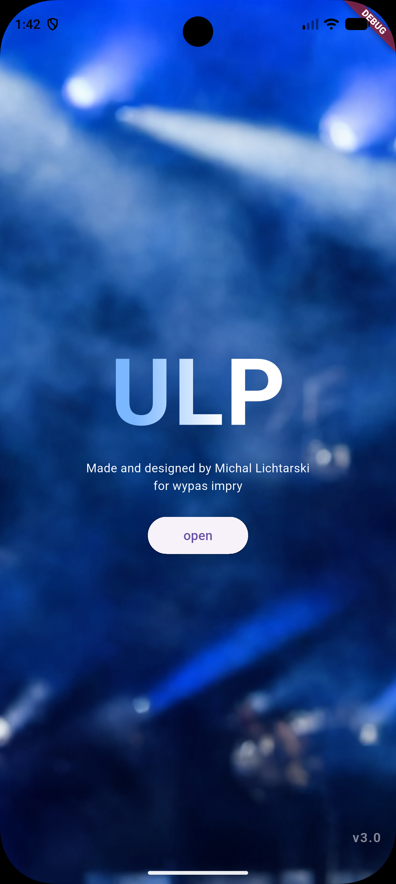
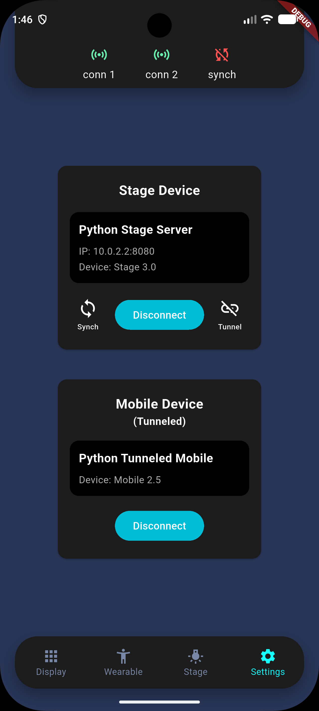
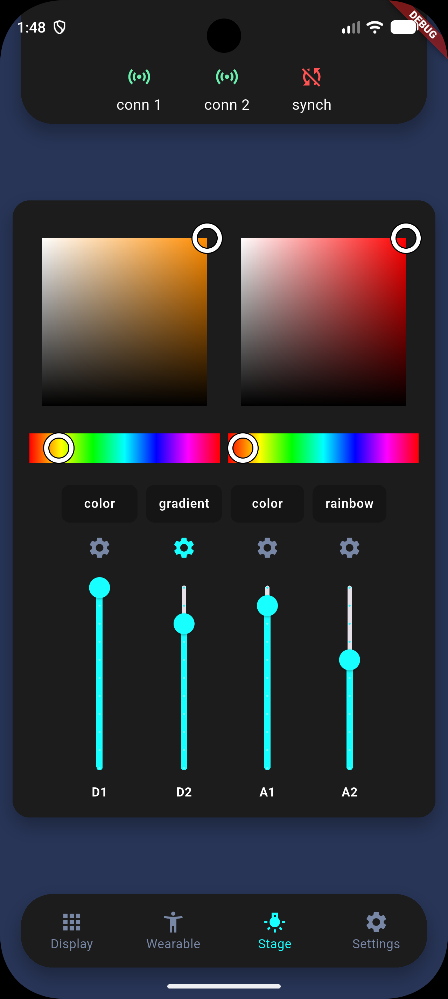
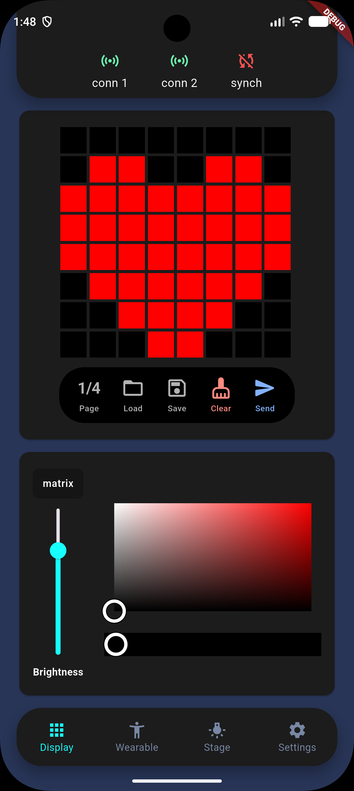

# ULP Mobile Control App

A Flutter-based mobile application designed to wirelessly control an LED lighting system. The app communicates over a network using a custom protocol, managing Stage and wearable Mobile devices within the ULP ecosystem.

## 📱 Screenshots

<table>
  <tr>
    <td align="center"><b>Splash Screen</b></td>
    <td align="center"><b>Settings</b></td>
    <td align="center"><b>Stage LED Mixer</b></td>
    <td align="center"><b>Wearable Matrix</b></td>
  </tr>
  <tr>
    <td></td>
    <td></td>
    <td></td>
    <td></td>
  </tr>
</table>

## 🌟 Key Features

### Stage Device
* **4-Channel LED Control:** Independently manage 4 LED channels (2 Addressable and 2 Analog strips).
* **Music-Reactive Effects:** Support for sound-reactive lighting effects.

### Wearable / Mobile Device
* **8x32 LED Matrix Drawing:** An interactive canvas allowing users to draw custom pixel art.
* **Text Display:** Send custom text to be rendered on the 8x32 LED matrix.
* **Single-Channel LED Strip:** Manage a single LED strip channel.
* **Music-Reactive Effects:** Support for sound-reactive lighting effects.

## 📡 Communication

The app relies on a custom event-driven TCP/IP communication layer. It utilizes a **Tunneling Architecture**, eliminating the need for the application to maintain simultaneous connections to multiple devices or rely on an external venue Wi-Fi network. Instead, one primary device can create its own Wi-Fi access point and act as a tunnel to forward commands to the secondary device.

For a complete breakdown, please refer to the protocol specification:

👉 **[Read the Full Protocol Documentation (PROTOCOL.md)](./docs/PROTOCOL.md)**

## 📂 Project Structure

The codebase is organized by feature and architectural layer to maintain separation of concerns:

```text
lib/
├── communication/   # TCP sockets, tunneling logic, and device managers
│   ├── devices/
│   ├── model/
│   └── transport/
├── data/            # Local storage (pixel sheets, app settings)
├── model/           # Data structures, effect enums, and JSON parsers
│   ├── mobile/
│   └── stage/
├── screens/         # UI screens for Settings, Stage, and Wearable
│   ├── settings/
│   ├── stage/
│   └── wearable/
├── utils/           # Helpers (colors, networking, routing)
└── widgets/         # Reusable UI components
```

## 🗺️ Roadmap

- **Wearable Front Display:** Add UI support for a secondary display on the wearable device.
- **Higher Back Display Resolution:** Upgrade the wearable back LED matrix to support higher-resolution
- **Matrix Animations:** Add support for playing animated sequences on the wearable LED displays.
- **Audio Hardware Integration:** Add support for dedicated audio hardware (ULP sound card)