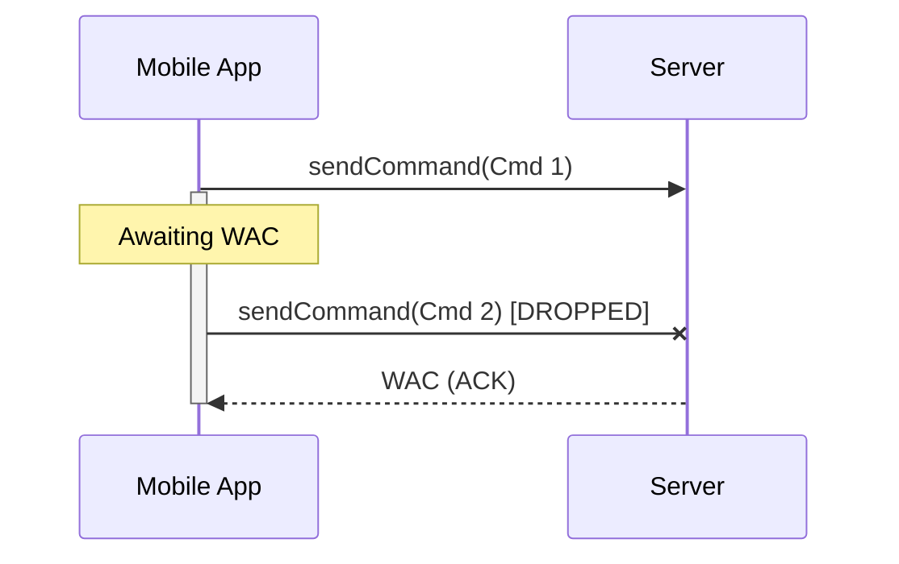
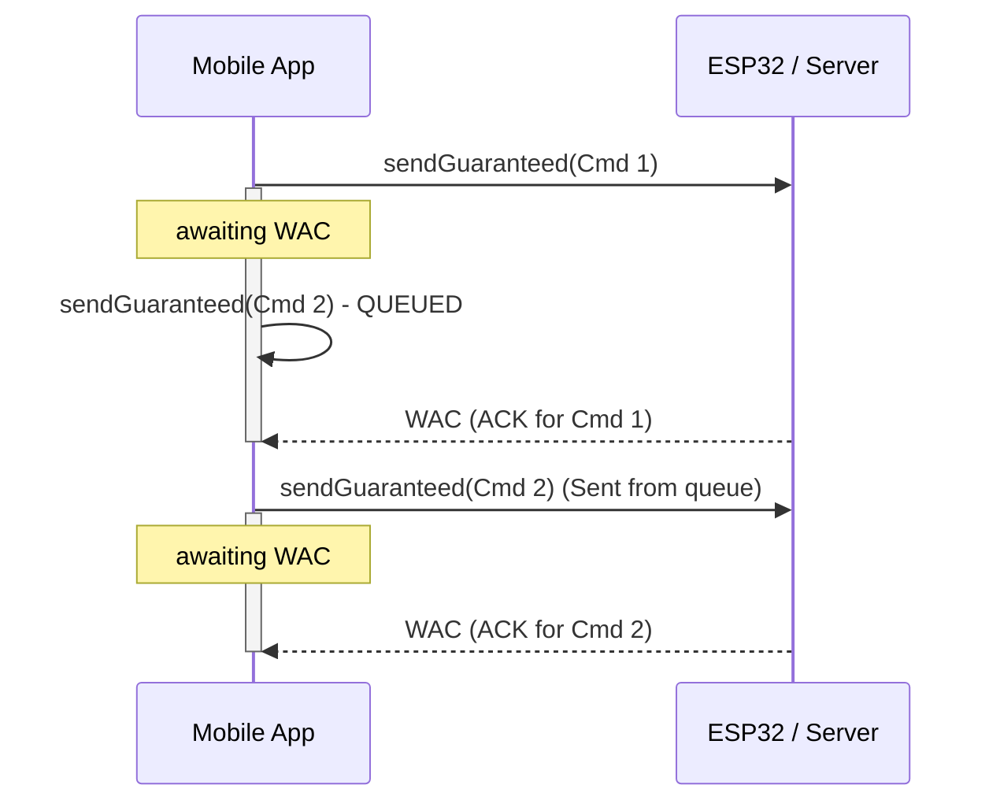
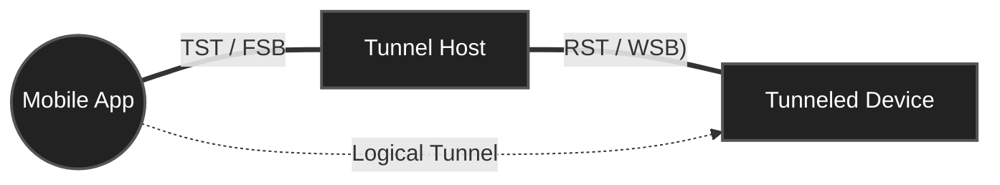
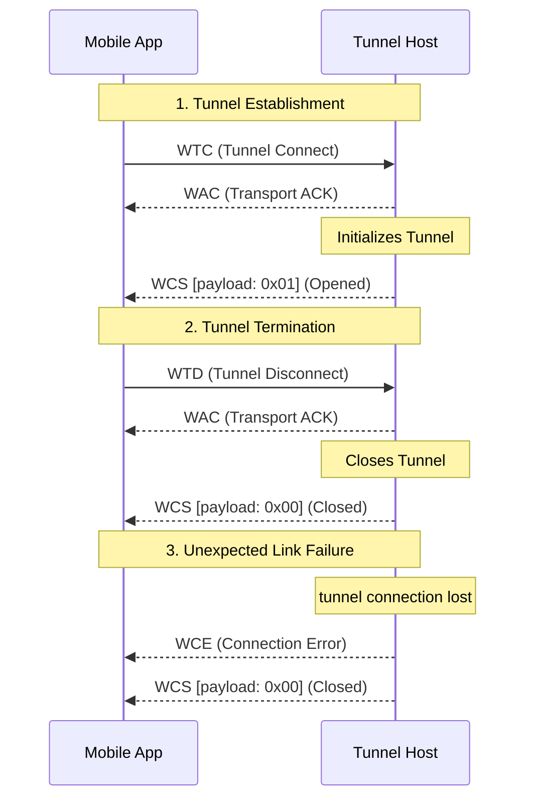

## 1. Packet Architecture

Symmetric, binary protocol. Multi-byte numeric fields use Big-Endian (Network Byte Order). Each packet has a 6-byte preamble followed by an optional payload.

```text
 0                   1                   2                   3
 0 1 2 3 4 5 6 7 8 9 0 1 2 3 4 5 6 7 8 9 0 1 2 3 4 5 6 7 8 9 0 1
+-+-+-+-+-+-+-+-+-+-+-+-+-+-+-+-+-+-+-+-+-+-+-+-+-+-+-+-+-+-+-+-+
|     Cmd[0]    |     Cmd[1]    |     Cmd[2]    |   Reserved    |
+-+-+-+-+-+-+-+-+-+-+-+-+-+-+-+-+-+-+-+-+-+-+-+-+-+-+-+-+-+-+-+-+
|          Length (BE)          |   Payload Data (0..N bytes) ...
+-+-+-+-+-+-+-+-+-+-+-+-+-+-+-+-+-+-+-+-+-+-+-+-+-+-+-+-+-+-+-+-+
```

### Fields

* **Cmd[0..2]** *(Offset 0, 3B)*: 3-character ASCII command identifier (e.g. `WAC`).
* **Reserved** *(Offset 3, 1B)*: Always `0x00`. Ensures 16-bit alignment on microcontrollers
* **Length** *(Offset 4, 2B)*: Payload size in bytes (`uint16_t`, Big-Endian).
* **Payload Data** *(Offset 6, N bytes)*: Raw message data. Omitted when `Length == 0`.

<br>

## 2. Transport Mechanism

The transport layer uses an explicit positive acknowledgment mechanism (`WAC`) to synchronize with microcontrollers.

### 2.1. Standard Transmission (Drop if Busy)
Used for non-critical or high-frequency updates (e.g., real-time slider dragging).
* If the socket is ready and not waiting for an ACK, the command is dispatched immediately.
* If the application is currently waiting for a `WAC` from a previous message, the new transmission request is **aborted immediately** (returns `false`) and is not queued.



### 2.2. Guaranteed Transmission (Queued)
Used for critical configuration changes that must reach the device.
* Commands are placed in an asynchronous execution queue.
* If the application is currently waiting for a `WAC`, the queue **blocks and waits** for the previous acknowledgment to resolve before sending the next payload.



### 2.3. Timeout Handling
Regardless of the sending method, once a command is pushed to the socket:
* The sender awaits a `WAC` packet (Command: `WAC`, Reserved: `0x00`, Length: `0x0000`).
* If the `WAC` does not arrive within `1.0 second`, a timeout occurs.
* Upon timeout, the application forcefully closes the socket connection and emits a connection error.

<br>

## 3. Multiplexing Layer (Tunneling)
The protocol utilizes a dual-endpoint multiplexing architecture over a single transport stream. This enables a single physical TCP connection to address two distinct logical devices simultaneously:

* **Tunnel Host (Primary Endpoint):** The directly connected network device terminating the physical TCP socket. It directly processes standard commands and manages the bridge lifecycle.
* **Tunneled Device (Secondary Endpoint):** A single secondary peripheral reached via the Host's internal bridge.

### 3.1. Command Prefix Translation

To route packets between the Tunnel Host and the Tunneled Device, the first byte of the 3-byte command type is swapped before transmission over the network and restored upon reception.

**Translation Rules:**
* **Read Operations (`R` $\leftrightarrow$ `T`):** 
  * Client $\rightarrow$ Tunneled Device: A standard read command, such as `RST` (Read Status), is sent over the network as `TST`.
  * Tunneled Device $\rightarrow$ Client: The incoming `TST` packet is translated back to `RST`.
* **Write Operations (`W` $\leftrightarrow$ `F`):** 
  * Client $\rightarrow$ Tunneled Device: A standard write command, such as `WSB` (Write Brightness), is sent over the network as `FSB`.
  * Tunneled Device $\rightarrow$ Client: An incoming tunneled response, such as `FST` (Tunneled Status Response), is translated back to `WST`.

<br>



### 3.2. Tunnel Lifecycle

The application manages the tunnel lifecycle by sending dedicated control commands to the Tunnel Host:

* **Establishment:** Initiated by the app via `TTC`. Confirmed by the Host via `TCS`.
* **Termination:** Closed manually by the app via `TTD`. Confirmed by the Host via `TCS`.
* **Error Handling:** If the secondary link drops unexpectedly, the Host emits a `TCE` followed by a `TCS` to broadcast the closed state.



<br>

## 4. Command Dictionary

This section defines the set of commands available in the protocol, categorized by devices

**Protocol Command Conventions:**
* `W..` (Write) — Writes data on the receiving side.
* `R..` (Read) — Requests data from the target.
* `F..` (Tunneled Write) — The tunneled counterpart of `W..` routed across the logical bridge.
* `T..` (Tunneled Read) — The tunneled counterpart of `R..` routed across the logical bridge.

### 4.1. Tunneling Management
Commands used to control the lifecycle of the logical tunnel. These commands are processed by the Tunnel Host.

| Code | Direction | Payload | Description |
| :--- | :--- | :--- | :--- |
| `WTC` | Client $\rightarrow$ Host | None (`0 B`) | Request to establish the logical tunnel to the secondary device. |
| `WTD` | Client $\rightarrow$ Host | None (`0 B`) | Request to terminate the active tunnel. |
| `WCS` | Host $\rightarrow$ Client | `1 B` (UInt8) | Tunnel connection status update (`0x01` = Connected, `0x00` = Disconnected). |
| `WCE` | Host $\rightarrow$ Client | String (UTF-8) | Tunnel connection error notification. |

### 4.2. Synchronization Control
Commands dedicated to managing the synchronization state between the primary and secondary devices. This mode typically enables continuous, real-time data streaming (e.g., audio/music synchronization data) across the link.

| Code | Direction | Payload (Parameters) | Description |
| :--- | :--- | :--- | :--- |
| `WSY` | Client $\rightarrow$ Host | `1 B` (UInt8) | Request to toggle real-time synchronization (`0x01` = enable, `0x00` = disable). |
| `WSS` | Host $\rightarrow$ Client | `1 B` (UInt8) | Current synchronization status update (`0x01` = active, `0x00` = inactive). |

> **Note:** Synchronization management (`WSY`) is supported exclusively by the **Stage** device.

### 4.3. Common Device Commands
These commands represent the universal control set for both devices.

| Code | Direction | Payload (Parameters) | Description |
| :--- | :--- | :--- | :--- |
| `WSB` | Client $\rightarrow$ Device | `2 B` (UInt8 index, UInt8 brightness) | Set brightness level (0-100) for a specific target index. |
| `WSS` | Client $\rightarrow$ Device | `2 B` (UInt8 index, UInt8 speed) | Set effect speed (0-100) for a specific target index. |
| `WSE` | Client $\rightarrow$ Device | `2 B` (UInt8 index, UInt8 effectID) | Set active effect ID for a specific target index. |
| `WSC` | Client $\rightarrow$ Device | `4 B` (UInt8 index, UInt8 R, G, B) | Set RGB color data for a specific target index. |

### 4.4. Device-Specific Commands
Commands that are unique to a particular hardware role.

| Code | Supported Device | Direction | Payload (Parameters) | Description |
| :--- | :--- | :--- | :--- | :--- |
| `WDT` | Mobile | Client $\rightarrow$ Device | `2+ B` (UInt8 displayId, UTF-8 String) | Write text to a specific display (`displayId` followed by text bytes). |
| `WDF` | Mobile | Client $\rightarrow$ Device | `2+ B` (UInt8 displayId, Raw Frame Bytes) | Send full display frame (byte 0 is `displayID`, the rest is `frameData`). |
| `WDF` | Mobile | Device $\rightarrow$ Client | `2+ B` (UInt8 displayId, Raw Frame Bytes) | Send full display frame (byte 0 is `displayID`, the rest is `frameData`). |
| `RDF` | Mobile | Client $\rightarrow$ Device | `1 B` (UInt8 displayId) | Request a display frame for a specific `displayId`. |

## 5. Status Payloads (JSON)

When a device responds to a Read Status (`RST`) command or actively pushes a status update, it sends a `WST` command containing a UTF-8 encoded JSON string as its payload. The structure of this JSON depends on the device type.

### 5.1. Mobile Device Status
The status payload for the Mobile device contains three main sections: a global synchronization flag, display module data, and LED strip module data.

**Example Payload:**
```json
{
  "synch": false,
  "displayData": {
    "displayText": "Hello World",
    "textColor": {
      "r": 255,
      "g": 255,
      "b": 255
    },
    "displayBrightness": 0.8,
    "displayEffect": 0
  },
  "stripData": {
    "brightness": 255,
    "speedEffect": 50,
    "effect": 1,
    "firstColor": {
      "r": 255,
      "g": 0,
      "b": 0
    },
    "secondColor": {
      "r": 0,
      "g": 0,
      "b": 255
    }
  }
}
```


### 5.2. Stage Device Status
The status payload for the Stage device contains a global synchronization flag and two distinct arrays for LED strips: one for addressable strips and one for analog strips. Both arrays must contain exactly two elements.

**Example Payload:**
```json
{
  "synch": false,
  "addressableStrips": [
    {
      "brightness": 255,
      "effect": 0,
      "sensitivity": 50,
      "threshold": 10,
      "smoothness": 5,
      "speedEffect": 80,
      "color1": { "r": 255, "g": 0, "b": 0 },
      "color2": { "r": 0, "g": 0, "b": 255 }
    },
    {
      "brightness": 128,
      "effect": 1,
      "sensitivity": 30,
      "threshold": 5,
      "smoothness": 2,
      "speedEffect": 40,
      "color1": { "r": 0, "g": 255, "b": 0 },
      "color2": { "r": 255, "g": 255, "b": 0 }
    }
  ],
  "analogStrips": [
    {
      "brightness": 255,
      "effect": 2,
      "sensitivity": 0,
      "threshold": 0,
      "smoothness": 0,
      "speedEffect": 50,
      "color1": { "r": 255, "g": 255, "b": 255 },
      "color2": { "r": 0, "g": 0, "b": 0 }
    },
    {
      "brightness": 0,
      "effect": 0,
      "sensitivity": 0,
      "threshold": 0,
      "smoothness": 0,
      "speedEffect": 0,
      "color1": { "r": 0, "g": 0, "b": 0 },
      "color2": { "r": 0, "g": 0, "b": 0 }
    }
  ]
}
```